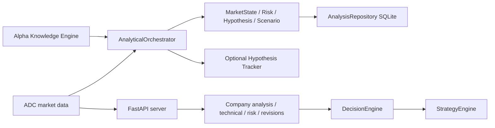

# Архитектура

Ниже — подтверждённая структура исходного main `a14ebf9c268bea5cb01de962edfb98b8df94652a`, не проверка live deployment.

Источники: [server.py](https://github.com/volk468-max/Analytical-Engine/blob/a14ebf9c268bea5cb01de962edfb98b8df94652a/aae/api/server.py), [orchestrator.py](https://github.com/volk468-max/Analytical-Engine/blob/a14ebf9c268bea5cb01de962edfb98b8df94652a/aae/core/orchestrator.py), [repository.py](https://github.com/volk468-max/Analytical-Engine/blob/a14ebf9c268bea5cb01de962edfb98b8df94652a/aae/storage/repository.py), [requirements](https://github.com/volk468-max/Analytical-Engine/blob/a14ebf9c268bea5cb01de962edfb98b8df94652a/requirements.txt). HTTP connectors получают внешние данные, orchestrator сохраняет analysis и при настройке регистрирует гипотезы. API и orchestrator — разные пути; схема не утверждает, что каждый endpoint проходит через orchestrator.

Зависимости runtime: FastAPI, uvicorn, pydantic, httpx, psycopg; pytest используется для тестов (requirements). Код не импортировался и endpoints не вызывались при аудите.

Research lineage: PR2 ← PR1; PR3/4 ← PR2; PR5 ← PR3; PR6 ← PR5; PR7 ← PR6; PR8 ← PR7. PR9–13 основаны на main, используют pinned snapshots: PR10 ← данные PR9; PR11 ← PR9/10; PR12/13 ← PR11. Источник: base/head в [каталоге](RESEARCH_INDEX.md) и sources/.

База GitHub docs/alpha-os-knowledge — документационная память. Runtime KnowledgeConnector — отдельный компонент, автоматическая синхронизация с этой папкой не реализована и не заявляется.
