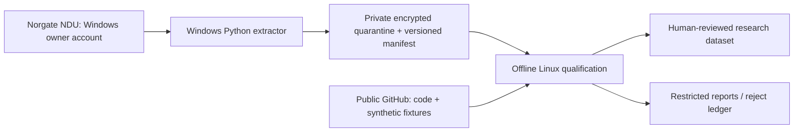

# Предлагаемая архитектура (не запущена)

1. Один владелец лицензии на Windows 10/11 либо поддерживаемом Windows Server с отдельным single-user account. NDU установлен, запущен и имеет действующий entitlement. Windows VM учитывается как NDU installation; документация допускает два concurrent installations, а не неограниченный shared server. Пароли только в защищённом профиле владельца, вне репозитория.
2. Ручной запуск извлечения после записи SDK/NDU versions, полного UTC времени, query window, actual database update times и настроек adjustment/padding. Обнаружить доступные databases/watchlists; перечислить текущие И выбывшие securities. Current-only watchlist запрещён как историческая universe. Список Current & Past полезен, но должен сверяться с complete databases + независимыми событиями.
3. Native Python API вызывается на Windows; Linux получает уже разрешённые приватные extracts. Railway не запускает NDU, не опрашивается и не меняется. Приватное исследовательское хранилище отделено от production DB/API, брокеров и торговых секретов.
4. Передача владельцу в его закрытое окружение по шифрованному каналу, без прав провайдера использовать данные самостоятельно. Отдельный encryption key, single-user ACL, запрет public/shared links, TTL, запрет backup без срока удаления. Конкретный cloud/LLM сервис требует проверки terms; разрешение на private cloud не означает разрешение обучения моделей третьей стороны или доступа других пользователей.
5. Linux quarantine проверяет файл, payload hash и contract, выдаёт локальный private report. Неуспех не приводит к автоматической починке/forward fill. После human review можно назначить engineering/qualified scope конкретному окну; это не permission менять production.
6. До истечения trial/subscription остановить использование и по принятому retention runbook удалить NDU copies, exports, normalized rows, metadata, caches, временные таблицы, object versions, snapshots/backups и content-bearing отчёты. Проверить cloud retention/object-lock ДО импорта: техническая невозможность своевременного удаления — NO-GO для выбранного storage.

## API surface по официальному Python reference N3

- `databases()`, `database(name)`: обнаружить реальный состав, включая US Equities Delisted; `watchlists()`/`watchlist(name)` — вспомогательная universe, не current-only filter.
- Вызовы принимают `assetid` вместо ticker. Сохранять namespace `norgate:<assetid>`; `symbol(assetid)` — CURRENT symbol, не история тикеров! Полный historical ticker mapping API этим проектом не придумывается: получить отдельно разрешённое evidence либо оставить unknown.
- `price_timeseries(assetid, stock_price_adjustment_setting=StockPriceAdjustmentType.NONE, padding_setting=PaddingType.NONE, ...)`: первичный raw OHLCV. Default в SDK — TOTALRETURN, поэтому setting должен быть явным и проверенным на trial. Сравнительный CAPITAL/TOTALRETURN export хранить отдельно с basis, не смешивать.
- `index_constituent_timeseries(assetid, '$SPX'/'$NDX', ...)`: отдельные daily membership states на общем calendar. Не ограничивать membership только датами, где нашёлся price bar: иначе halted/missing members исчезнут из знаменателя. Отсутствие ряда не является state=0.
- `capital_event_timeseries`, `padding_status_timeseries`: evidence flags. Capital-event flag не содержит универсального typed split/merger ledger или original announcement timestamp. Недостающие ratio/payment/effective details должны оставаться UNKNOWN до независимого разрешённого evidence.
- `last_database_update_time`/`last_price_update_time` означают время локального обновления, не original historical publication/price date. Не переносить их в `available_at` прошлого.

Это спецификация adapter, не выполненный extraction и не гарантированный рабочий exporter. После trial нужен compatibility test точных SDK signatures/dtypes/даты окончания. NDU ASCII/CSV export не экспортирует membership; нужен поддерживаемый API. Источники N3/N4/N5: https://pypi.org/project/norgatedata/, https://norgatedata.com/accessibility.php, https://norgatedata.com/faq.php.
