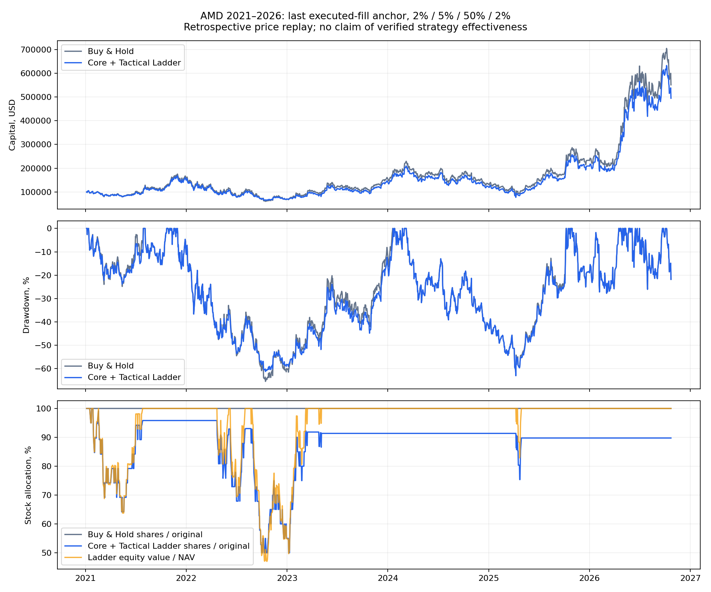

# AMD — Alpha Core + Tactical Ladder v1

**Research only. No changes to Decision Engine, Tactical Risk Overlay, production services or live trading. No merges.**

Coverage: 2021-01-04–2026-10-22, 1458 completed OHLCV sessions. 1 January 2021 was a market holiday; first entry is 4 January. 23 October 2026 is deliberately excluded. Source: Yahoo chart, retrieved 2026-10-23T16:41:37.107583+00:00. Raw source, normalized OHLCV, action metadata and SHA-256 hashes are committed in data/core-tactical-ladder.

## Fixed control and main comparison

Control: sale step 2%, sale/buy quantity 5% of initial executed shares, core floor 50%, buy step 2%; $100,000 initial capital, 5 bps commission and 5 bps adverse slippage each side. One next-eligible-open execution after a completed-bar signal. No leverage, shorting, cash interest, external cash top-ups or forced terminal liquidation.

| Metric | Buy & Hold | Ladder control |
|---|---|---|
| initial_equity | 100000.0000 | 100000.0000 |
| final_equity | 550887.4607 | 494460.4029 |
| return_pct | 450.8875 | 394.4604 |
| cagr_pct | 34.2280 | 31.7489 |
| max_drawdown_pct | -65.4499 | -63.0003 |
| max_drawdown_duration_sessions | 535.0000 | 536.0000 |
| annualized_volatility_pct | 55.3996 | 53.0272 |
| sharpe_rf_zero | 0.8064 | 0.7832 |
| sortino_rf_zero | 1.2448 | 1.2112 |
| buys | 1.0000 | 85.0000 |
| sells | 0.0000 | 83.0000 |
| commissions | 49.9750 | 409.5201 |
| slippage_dollars | 49.9500 | 409.4953 |
| turnover_initial_capital | 0.9995 | 8.1904 |
| average_share_fraction | 1.0000 | 0.8790 |
| minimum_share_fraction | 1.0000 | 0.5000 |
| average_equity_weight | 1.0000 | 0.9484 |
| maximum_cash_weight | 0.0000 | 0.5300 |
| average_cash | 0.0000 | 4098.0268 |
| final_cash | 0.0000 | 0.0000 |
| final_shares | 1084.5736 | 973.4814 |
| initial_capital_recovery_date | 2021-01-04 | 2021-01-04 |
| initial_capital_first_loss_date | 2021-01-06 | 2021-01-06 |
| initial_capital_recovery_after_loss_date | 2021-01-07 | 2021-01-07 |
| initial_capital_recovery_after_loss_sessions | 1.0000 | 1.0000 |

Ladder minus Buy & Hold: -56.43 percentage points of total return; maximum-drawdown change 2.45 percentage points (positive = shallower drawdown). Positive FIFO missed-recovery diagnostic including modeled trade costs: $71211.98; this is not additive net P&L attribution.

## Exact state machine and boundary behavior

PR #2 provides the shared Bar/time schema and cost/next-open assumptions. Its executor targets NAV weights and restores after HOLDs, which does not implement a fixed-original-quantity ladder; this isolated quantity executor is therefore separate and does not modify that executor. The reference is the actual adverse fill price of the initial purchase, then of each nonzero tactical execution. Commission is a separate cash debit. Price thresholds are inclusive. At a lower or upper quantity boundary the reference freezes; it is never moved to a later-known peak/trough. A rising fully invested position therefore does not trail a new high, and a falling core-only position does not trail a new low. This path dependence can leave the ladder inactive through large peak-relative moves or delay repurchase far into a recovery.

At most one outstanding order and one fill per session. Close-time orders execute at the next available open strictly after publication; delayed variants wait additional eligible opens. Orders are not revalidated against the new open. The daily adapter requires publication before the following session open; it rejects late feeds instead of reordering decisions across an intervening fill. A general asynchronous event-clock adapter is outside this v1. A gap fills one quantity step at the actual available open, never a sequence of fictional threshold fills. Further signals wait for a later completed bar. Unfilled terminal orders remain pending.

Share limits concern quantity, not portfolio weight: keeping 50% of original shares may leave less than 50% of NAV in AMD after a deep decline. Buy quantities cannot exceed previously sold units or available cash including costs. The control allows affordable fractional partial buys; it cancels any unfilled remainder. Any nonzero partial fill updates the reference to that fill. No-fill rejection freezes it. Partial-liquidity sensitivity caps tactical orders only; the initial benchmark package remains fully funded. It uses deterministic one-shot quantity caps, not a realistic order-book model.

## Cycles and inherited state

All >=10% closing-peak drawdowns that subsequently recover their prior closing peak are included. These are retrospective episode labels only; no extrema enter trading signals. Open cycles are right-censored. All calendar quarters are also included, without profit-based selection: strong growth = >=20% open-to-last-close return; deep decline = <=-20%; sideways oscillation = absolute return <=10% and closing range >=15%. Long corrections are identified by cycle duration >=126 sessions. Nested shorter drawdowns inside an unrecovered peak excursion are not independent complete cycles.

Every episode has A: independent $100,000/full-position entry; B: slices of the same uninterrupted 2021 state, including pending orders, cash and last executed reference. Continuous returns use the previous close NAV as entry capital; independent returns include fresh entry costs. Peak-boundary independent entries are ex-post diagnostic windows, not an executable peak-timing strategy. Inherited accounts can have different initial NAV, so compare their percentage returns rather than dollar endpoints.

| Episode | Regime | Complete | A Ladder / B&H return % | B Ladder / B&H return % |
|---|---|---|---|---|
| cycle_1 | prolonged_correction | True | -0.40 / 4.04 | -0.79 / 3.54 |
| cycle_2 | correction_recovery | True | 2.48 / 4.24 | 6.01 / 6.01 |
| cycle_3 | deep_decline_recovery | True | -4.24 / 3.18 | 0.19 / 5.08 |
| cycle_4 | deep_decline_recovery | True | -7.67 / -0.57 | -1.34 / 0.42 |
| cycle_5 | correction_recovery | True | -3.85 / 5.22 | 7.85 / 7.85 |
| cycle_6 | correction_recovery | True | 1.13 / 2.43 | 4.93 / 4.93 |
| cycle_7 | correction_recovery | True | 8.47 / 12.71 | 14.09 / 14.09 |
| open_cycle | correction_recovery | False | -19.78 / -21.70 | -19.60 / -19.60 |
| 2021Q1 | mixed | True | -14.86 / -14.86 | -14.86 / -14.86 |
| 2021Q2 | mixed | True | 15.96 / 17.06 | 14.92 / 19.66 |
| 2021Q3 | sideways_oscillation | True | 9.03 / 9.31 | 9.29 / 9.55 |
| 2021Q4 | strong_growth | True | 39.85 / 40.11 | 39.84 / 39.84 |
| 2022Q1 | deep_decline | True | -27.64 / -24.74 | -24.02 / -24.02 |
| 2022Q2 | deep_decline | True | -27.52 / -30.85 | -29.33 / -30.06 |
| 2022Q3 | mixed | True | -15.39 / -15.82 | -12.73 / -17.14 |
| 2022Q4 | sideways_oscillation | True | 0.06 / 0.38 | 0.39 / 2.23 |
| 2023Q1 | strong_growth | True | 47.57 / 48.35 | 38.75 / 51.32 |
| 2023Q2 | mixed | True | 15.73 / 17.68 | 15.63 / 16.22 |
| 2023Q3 | mixed | True | -12.19 / -10.80 | -9.74 / -9.74 |
| 2023Q4 | strong_growth | True | 42.15 / 44.08 | 43.37 / 43.37 |
| 2024Q1 | strong_growth | True | 24.75 / 24.97 | 22.44 / 22.44 |
| 2024Q2 | sideways_oscillation | True | -11.17 / -10.02 | -10.13 / -10.13 |
| 2024Q3 | sideways_oscillation | True | -2.26 / 1.65 | 1.15 / 1.15 |
| 2024Q4 | deep_decline | True | -24.43 / -26.64 | -26.38 / -26.38 |
| 2025Q1 | mixed | True | -16.30 / -16.07 | -14.94 / -14.94 |
| 2025Q2 | strong_growth | True | 35.62 / 38.76 | 35.70 / 38.12 |
| 2025Q3 | mixed | True | 16.25 / 16.47 | 14.02 / 14.02 |
| 2025Q4 | strong_growth | True | 32.94 / 32.94 | 32.37 / 32.37 |
| 2026Q1 | sideways_oscillation | True | -9.27 / -7.16 | -5.01 / -5.01 |
| 2026Q2 | strong_growth | True | 179.56 / 179.56 | 185.56 / 185.56 |
| 2026Q3 | sideways_oscillation | True | 4.55 / 9.62 | 5.31 / 5.31 |
| 2026Q4 | mixed | False | -16.95 / -17.18 | -16.97 / -16.97 |
| Sep_Oct_2026_diagnostic | correction_recovery | False | 10.33 / 10.33 | 7.90 / 7.90 |

Reset effect example, cycle_4 (2024–2025): independent entry reduces local maximum drawdown by 18.08 pp, while the inherited strategy changes it by 0.00 pp. Resetting the executed reference near an ex-post peak is materially different from carrying the old reference and exhausted cash; independent-cycle protection must not be attributed to the uninterrupted strategy.

### Completed-quarter regime aggregates

Arithmetic means of non-overlapping completed calendar quarters only; labels are retrospective, not strategy signals.

| Method | Regime | Quarters | Mean relative return pp | Mean drawdown reduction pp |
|---|---|---|---|---|
| independent | deep_decline | 3 | 0.88 | 1.55 |
| independent | mixed | 7 | -0.64 | 0.43 |
| independent | sideways_oscillation | 6 | -2.14 | 1.06 |
| independent | strong_growth | 7 | -0.90 | 0.10 |
| continuous | deep_decline | 3 | 0.25 | 0.24 |
| continuous | mixed | 7 | -0.13 | 1.57 |
| continuous | sideways_oscillation | 6 | -0.35 | 0.99 |
| continuous | strong_growth | 7 | -2.14 | 0.12 |

## Parameters, costs and execution

All 144 parameter combinations are retained: sell step 1/2/3/4%, quantity 2.5/5/10%, minimum 40/50/60/70%, buy step 2/3/4%. The 50% core promise applies to the fixed control; experimental floors explicitly redefine the untouched quantity. sensitivity.csv contains full history, development 2021–2023, validation 2024–2026 independently funded, and validation with inherited state for every combination. No parameter winner is selected. This chronological split is not an unseen prospective holdout: the research was specified after historical markets were observable.

Execution grid: commission 0/5/10/25 bps × slippage 0/5/10/25 bps × delays 1/2/3 sessions, plus whole-share/10-share lots, half-sized one-shot partial fills, and rejection rather than affordable partial filling. Lot sizes floor trade quantities and never force the core below its limit. Initial strategic shares are defined by the actual fully funded initial lot; initial order is an ex-ante benchmark commitment, not a decision based on its future close.

| Family/window | Count | Relative return range pp | Drawdown reduction range pp |
|---|---|---|---|
| parameters/full | 144 | -274.78 to -5.19 | 0.04 to 27.68 |
| parameters/development | 144 | -48.82 to -1.51 | 0.04 to 28.93 |
| parameters/validation_carry | 144 | -121.57 to 0.00 | 0.00 to 25.47 |
| parameters/validation_independent | 144 | -156.04 to -0.84 | 0.13 to 21.85 |
| execution/full | 48 | -186.52 to -40.64 | 1.36 to 10.36 |
| rounding_partial/full | 5 | -56.41 to -30.51 | 1.54 to 2.45 |

### Rounding and one-shot partial execution

| Variant | Final capital $ | Return % | Max drawdown % | Final shares | Buys / sells |
|---|---|---|---|---|---|
| ladder_base_continuous | 494460.40 | 394.46 | -63.00 | 973.4814 | 85 / 83 |
| whole_shares | 494243.24 | 394.24 | -62.98 | 973.0000 | 85 / 83 |
| lots_of_10 | 493293.88 | 393.29 | -62.93 | 970.0000 | 84 / 83 |
| half_fill_cancel | 520117.39 | 420.12 | -63.40 | 1023.9942 | 88 / 85 |
| whole_half_fill | 520139.36 | 420.14 | -63.39 | 1024.0000 | 88 / 85 |
| reject_unaffordable_partial | 498945.67 | 398.95 | -63.91 | 976.1162 | 52 / 53 |

### Execution sensitivity examples (full grid retained)

| Commission / slippage bps | Delay sessions | Return % | Relative return pp | Max drawdown % |
|---|---|---|---|---|
| 0 / 0 | 1 | 397.38 | -54.06 | -63.00 |
| 5 / 5 | 1 | 394.46 | -56.43 | -63.00 |
| 10 / 10 | 1 | 320.91 | -129.42 | -62.98 |
| 25 / 25 | 1 | 324.56 | -124.13 | -62.98 |
| 5 / 5 | 2 | 365.76 | -85.12 | -63.00 |
| 5 / 5 | 3 | 283.53 | -167.36 | -55.22 |

Delays change the sequence of actual fills and references, not just a fixed return haircut. These examples and the grid do not select a preferable execution setting.

### Cash and missing shares

At the endpoint, cash contributes $-0.00 to relative NAV, while the share-value difference contributes $-56427.06. Their sum exactly equals the strategy-minus-benchmark capital difference. cash-impact.csv gives this daily identity. Final wealth is -10.24% below the benchmark; this is distinct from the -56.43 percentage-point difference in total return. Idle cash can cushion a decline, but cash depletion and smaller repurchased quantities can leave a permanent share deficit with no remaining cash buffer.

### Control state constraints

No-cash BUY blocks: 1071; frozen lower-bound observations: 0; frozen upper-bound observations: 4. A quantity deficit can persist while equity weight is 100%: this means the account owns fewer shares after costly repurchases, not that tactical cash is still available.

Across the predeclared full-history grid, 144 of 144 configurations underperform Buy & Hold by total return; 144 reduce maximum drawdown. This documents a trade-off, not a selected best strategy or an independent success test.

## Five research questions

1. **Drawdown:** the control changes maximum drawdown by 2.45 pp; see the table for its duration and volatility. Core retention and cash reserves can cushion losses, but a frozen upper reference is not a trailing risk stop.
2. **Recovery cost:** matched repurchase price/cost gaps total $24512.45; remaining sold-unit terminal marking is $46699.53. The separate net return difference is -56.43 pp. Cash earns zero; repurchases may be cash-starved and cannot magically restore the original shares.
3. **Adverse round trips:** 53 of 84 buy executions matching earlier sales cost more per matched unit than FIFO sale proceeds (including modeled fees/slippage). A buy can match several sales; this is a descriptive execution-sequence count, not an independent statistical trial.
4. **Robustness:** all neighboring configurations and costs are published, with development/validation segments separated. Ranges above quantify sensitivity rather than proving stability. Repeated inspection of this history prevents claims of independent optimization success.
5. **Usefulness:** on this dataset the fixed control does not demonstrate a more favorable overall profile: its Sharpe is 0.783 versus 0.806 for Buy & Hold, while a 2.45 pp shallower worst drawdown costs 56.43 pp of total return. An investor may value a different point on this trade-off, but the 50% share floor is not a 50% drawdown cap. Retrospective prices and simplified execution prevent an effectiveness claim; no production recommendation follows.

Regime comparisons are in the complete episode table, including strong growth, falling markets, prolonged recovery, sideways oscillation and the separately mandated September–October 2026 slice. Static boundaries can miss strong growth after cash becomes exhausted and can also avoid buying a still-declining position. Episode labels are not predictive market-regime inputs.

## Metric definitions, data limits and reproduction

- Run `python scripts/fetch_ladder_data.py` only to refresh the frozen research source, then `python -m aae.backtest.ladder_research`. Report reproduction itself is offline. Install requirements-research.txt for matplotlib; numerical accounting uses the standard library.
- OHLCV and reported actions use one provider vintage and one consistent price basis. AMD reports no in-window splits or dividends; adjusted close equals close for every retained row. Adjusted close is not mixed into signals. Action completeness and nominal-price fidelity are not independently attested. The importer refuses action-bearing/mismatched adjusted data rather than silently mixing prices. The simulator applies known splits prospectively to holdings, original-unit limits, pending quantities and the reference. Dividend-bearing data require an ex-date entitlement/payment-date ledger and are explicitly refused by this data adapter.
- Availability is inferred as next UTC midnight after the session; fixed open+6.5h close attribution delays early closes conservatively. Prices/volumes are retrospective and can be revised. Missing sessions are not interpolated. No historical broker quotes, capacity constraints, partial-fill probabilities, taxes, dividend reinvestment, cash yield or independent exchange calendar are available.
- Maximum drawdown uses daily-close NAV including entry costs; duration is the longest consecutive run below the previous NAV high, including right-censored runs. No intraday drawdown claim. initial_capital_recovery_date is the first close >= initial NAV; additionally, recovery_after_loss records the first recapture after an actual underwater close and its session wait. Blank after-loss fields mean no such recapture (or no initial-capital loss); flags distinguish these cases. None is a synthetic future peak-recovery date.
- CAGR uses actual elapsed calendar days and is blank for periods shorter than a year. Sample standard deviation of daily simple NAV returns is annualized by sqrt(252). Sharpe uses zero risk-free rate; Sortino uses zero target and root-mean-square negative returns over all observations. Zero/insufficient denominators yield blank, never infinity. These are descriptive annualized ratios, without normality/independence claims.
- Turnover is total absolute filled notional / episode initial capital, including initial entry where applicable. Average cash is actual idle dollars; stock value and cash sum to NAV each day. share_fraction and equity_weight are separately reported. Continuous period loss/return comparisons use each strategy own inherited capital. Episode drawdown peaks reset to that window initial NAV; full-history drawdown is measured separately without resetting account state.
- FIFO missed-recovery cost is positive buy cost minus matched sale proceeds plus positive terminal value of unmatched sold units. It can persist after invested weight rises, and is not exact causal return attribution. Positive and negative matched sequences are not netted into this diagnostic. For continuous subwindows missed_recovery_dollars describes new within-window sales. Additional inherited_missed_recovery_at_start/end/change fields use the full prior FIFO ledger at both boundaries, retaining earlier sold lots; the change can be negative when terminal marks decline. NAV, returns and trading state remain fully inherited.
- trades.csv includes fills for controls, independent episodes, full/validation parameter variants and execution variants. daily-equity.csv, position-history.csv and events.csv record controls, independent episodes and rounding/partial variants; grid daily paths are reproducible from the recorded configuration rather than duplicating hundreds of large paths in Git. episodes.csv continuous slices refer to the corresponding full-history journals.
- Source/output/code hashes, fixed configuration, chronological split and completed-cycle count are in run.json; validation.md records tests. All values for incomplete episodes stop at observed last marks, not fictional future recovery.
