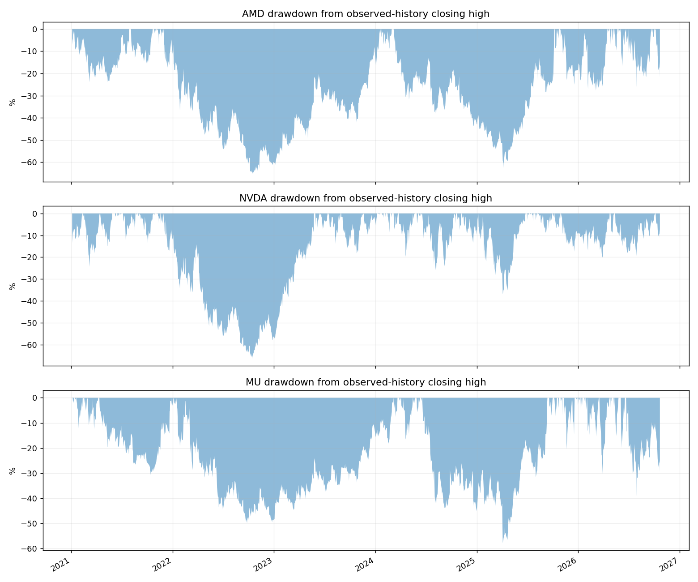
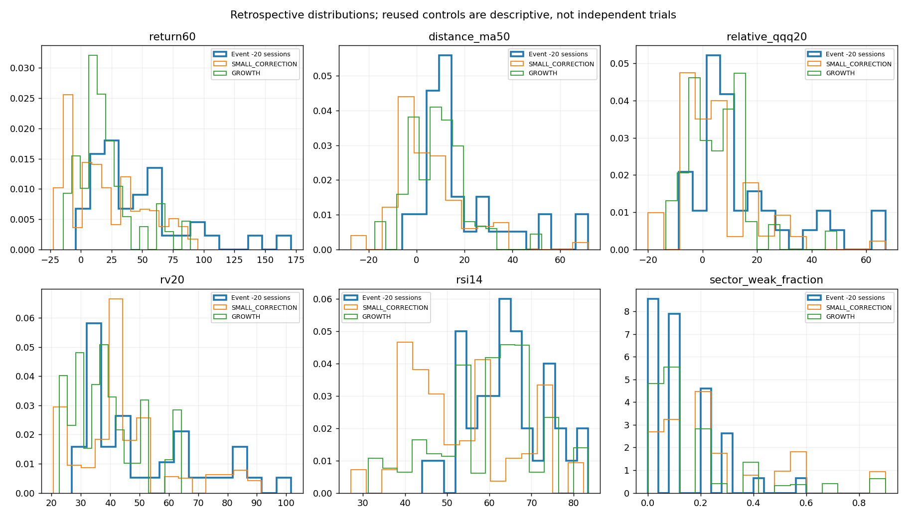
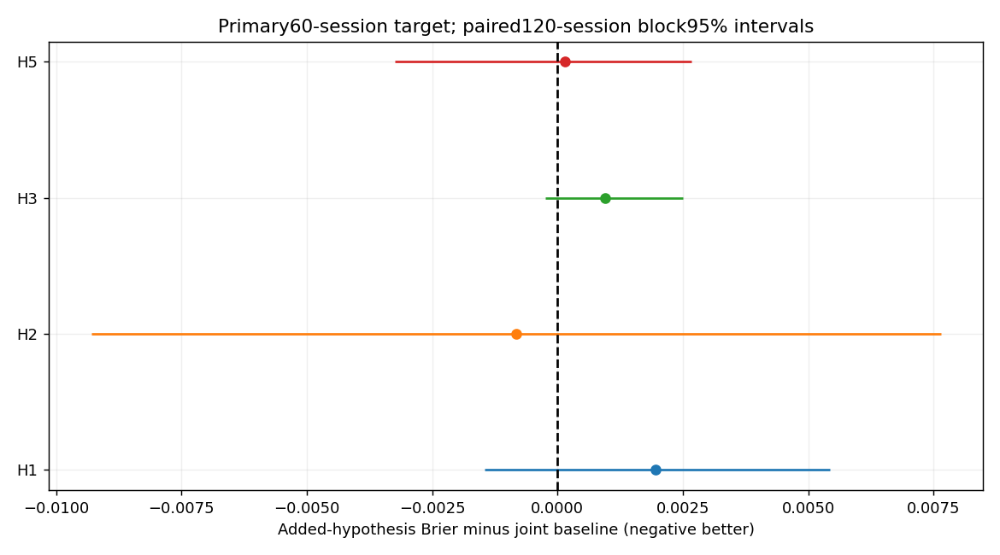

# Historical Drawdown Anatomy v1

**Research only: no trades, position sizing, signal edits or production integration.** Event definitions and H1–H5 were frozen before association tests (protocol commit c8d0b6f). Catalogue construction precedes feature associations.

## Data and limits of historical interpretation

Primary AMD/NVDA/MU plus15 requested additional survivors,2021–22 October2026,2020 warmup. Frozen primary/QQQ/SOX/CBOE VIX data from PR#5 are unchanged. Additional Yahoo OHLCV/action responses and FRED DGS10 were retrieved for this study; sources, retrieval times, completeness, corporate actions, publication assumptions and SHA-256 are in data-coverage.csv and data/historical-drawdown-anatomy/manifest.json. Prices are one provider split-adjusted basis, not dividend total returns; splits are never applied twice.

Every feature uses a published prefix. Price availability is assumed next UTC midnight (early closes delayed); DGS10 is assumed known only after two subsequent QQQ sessions and next midnight. These are conservative scheduling assumptions, NOT independently attested original publication vintages. No present-day EPS/PE/guidance substitutes are used. Market-wide breadth, revision vintages and historical sector membership remain unavailable (missing-data.md).

PLTR begins September2020 and lacks early200-session warmup; long-window features stay missing until observable. Missing-control matches stay NO_MATCH. The selected names all survived to2026, so cross-stock findings are conditional on a survivor basket and cannot establish a survivorship-free sector law. Sector concentration is a fixed11-semiconductor peer proxy, excluding the target, not whole-market breadth.

2021–2022 are discovery/training; annual2023–2026 probabilities use only fully matured outcomes at each Jan1 cutoff. The same2021–2026 history has already been studied repeatedly: chronological testing prevents computational look-ahead but is not pristine independent confirmation. Newly added stocks check transport of a frozen specification, not historically blind hypothesis discovery.

## Catalogue and nested episodes

Closing high-water mark starts at the first available2020 observation. It is an observable-history high, not a verified lifetime ATH. A decline starts on the first lower close after that peak; all nested falls belong to the same episode until the old peak is genuinely recovered. Threshold dates use closes. Severity buckets are[10,15),[15,25],>25%. Open and left-censored events remain. Peaks/troughs describe labels only, never predictor inputs.

| Stock | Events | 10–15% | 15–25% | >25% | Open |
|---|---|---|---|---|---|
| AMD | 8 | 0 | 4 | 4 | 1 |
| NVDA | 15 | 6 | 6 | 3 | 1 |
| MU | 15 | 5 | 5 | 5 | 1 |
| AVGO | 12 | 7 | 0 | 5 | 1 |
| AMAT | 10 | 5 | 2 | 3 | 1 |
| LRCX | 12 | 3 | 6 | 3 | 1 |
| TSM | 10 | 3 | 5 | 2 | 1 |
| MRVL | 5 | 0 | 1 | 4 | 1 |
| INTC | 3 | 0 | 1 | 2 | 1 |
| QCOM | 5 | 0 | 1 | 4 | 1 |
| TXN | 9 | 4 | 2 | 3 | 1 |
| AMZN | 7 | 1 | 4 | 2 | 1 |
| META | 6 | 0 | 3 | 3 | 1 |
| MSFT | 5 | 2 | 1 | 2 | 0 |
| GOOGL | 6 | 1 | 3 | 2 | 1 |
| PLTR | 7 | 1 | 3 | 3 | 1 |
| CRM | 4 | 0 | 0 | 4 | 1 |
| ADBE | 3 | 0 | 2 | 1 | 1 |

Catalogue sensitivities use high/low extrema,98% recovery or12% inclusion instead of10%. All variants are exported; no definition is selected for a favorable result. high/low is a daily descriptive sensitivity with close-confirmed recovery, not an assumed intraday path. See episode-sensitivity.csv; differences in count/duration warn against treating one segmentation as ground truth.

## Presnapshots and mandatory controls

Each event has60/40/20/10/5-session causal snapshots before the first declining session. Confirmed significant lows require five already-observed sessions on each side and a preceding20-session decline of at least5%; an eventual event trough is never reused as an earlier feature. Features include growth/MA distances, relative strength/change, RV/RSI/slopes/volume/negative sessions/acceleration/correlation, lagged VIX/yields and peer deterioration.

Controls come from a fixed every20th-session cohort, classified using a complete60-session future into large/small correction, continuing growth, sideways or mixed. Matching is same stock, causal QQQ regime and two-year block, nearest dates excluding20 sessions around the snapshot, up to3 per category. Selection never ranks feature values. Reuse is explicit and inverse-weighted; controls are descriptive, not population probabilities or independent trial counts. Cohort-all.csv preserves mixed/censored dates too.

Snapshots: 710; matched/control records: 5792, of which 921 explicitly unmatched. Matched rates by offset/category are in matched-control-comparison.csv; population risk/false-warning rates use the whole predeclared cohort, never case-enriched matches.

## Individual features before combinations (exploratory)

| Flag | Exposed anchors / hits | Risk ratio [95%CI] | False warnings | Holm p | Support |
|---|---|---|---|---|---|
| ret20 | 46 / 18 | 0.821 [0.587, 1.198] | 0.609 | 1.000 | RESEARCH_DEPENDENT_ESTIMATE |
| ret60 | 55 / 25 | 1.029 [0.721, 1.615] | 0.545 | 1.000 | RESEARCH_DEPENDENT_ESTIMATE |
| ret120 | 53 / 27 | 1.258 [0.713, 2.664] | 0.491 | 1.000 | RESEARCH_DEPENDENT_ESTIMATE |
| low_rise | 23 / 8 | 0.743 [0.393, 1.177] | 0.652 | 1.000 | LOW_SUPPORT |
| growth_deceleration | 56 / 25 | 0.998 [0.615, 1.650] | 0.554 | 1.000 | RESEARCH_DEPENDENT_ESTIMATE |
| ma50_extension | 49 / 21 | 0.936 [0.583, 1.515] | 0.571 | 1.000 | RESEARCH_DEPENDENT_ESTIMATE |
| ma200_extension | 68 / 31 | 1.042 [0.714, 1.849] | 0.544 | 1.000 | RESEARCH_DEPENDENT_ESTIMATE |
| relative_weakness | 29 / 10 | 0.725 [0.253, 1.015] | 0.655 | 1.000 | RESEARCH_DEPENDENT_ESTIMATE |
| sector_weakness | 13 / 4 | 0.666 [0.000, 1.954] | 0.692 | 1.000 | LOW_SUPPORT |
| rsi_overbought | 16 / 4 | 0.527 [0.150, 0.911] | 0.750 | 1.000 | LOW_SUPPORT |
| ma20_falling | 47 / 22 | 1.075 [0.603, 1.732] | 0.532 | 1.000 | RESEARCH_DEPENDENT_ESTIMATE |
| volume_surge | 12 / 6 | 1.132 [0.324, 1.822] | 0.500 | 1.000 | LOW_SUPPORT |
| negative_sessions | 22 / 5 | 0.463 [0.000, 1.014] | 0.773 | 1.000 | LOW_SUPPORT |
| fall_acceleration | 55 / 26 | 1.103 [0.735, 1.718] | 0.527 | 1.000 | RESEARCH_DEPENDENT_ESTIMATE |
| correlation_rise | 33 / 15 | 1.023 [0.665, 1.415] | 0.545 | 1.000 | RESEARCH_DEPENDENT_ESTIMATE |
| vix_stress | 3 / 0 | 0.000 [—, —] | 1.000 | — | LOW_SUPPORT |
| yield_change | 30 / 13 | 0.961 [0.556, 1.622] | 0.567 | 1.000 | RESEARCH_DEPENDENT_ESTIMATE |
| rv_ratio | 41 / 15 | 0.757 [0.477, 1.109] | 0.634 | 1.000 | RESEARCH_DEPENDENT_ESTIMATE |

All18 flags are shown; cohort risk associations are not evidence of added predictive information. The full fixed family receives exploratory Holm adjustment. Sparse exposures remain LOW_SUPPORT.

## Five prespecified candidate patterns

| Hypothesis | Exact definition | Status |
|---|---|---|
| H1 | ret60>=20%, MA50 extension>=10%, RV20/RV60>=1.10 | INCREMENTAL_ADVANTAGE_NOT_CONFIRMED |
| H2 | 20-session relative weakness<=-5pp versus a still-rising QQQ or SOX | INCREMENTAL_ADVANTAGE_NOT_CONFIRMED |
| H3 | >=50% peers falling over10 sessions and underperforming QQQ by>=3pp;>=5 peers | INCREMENTAL_ADVANTAGE_NOT_CONFIRMED |
| H4 | Original historical EPS/guidance downgrades | CANNOT_TEST: no original fundamental expectation vintages |
| H5 | QQQ belowMA50, rising market RV, VIX stress/change and abs lagged yield20 change>=25bp | INCREMENTAL_ADVANTAGE_NOT_CONFIRMED |

These five are the user-specified candidates, not a post-hoc ranking of winners. All18 single flags are also retained with exploratory multiplicity adjustment. Descriptive recurrence before a handful of falls is not confirmation.

## Matched control frequencies: primary stocks,20-session presnapshot

| Pattern | Event prevalence (N) | Small correction | Continuing growth | Sideways |
|---|---|---|---|---|
| H1 | 0.289 (38) | 0.147 (unique=36) | 0.031 (unique=37) | — (unique=0) |
| H2 | 0.158 (38) | 0.217 (unique=36) | 0.191 (unique=37) | — (unique=0) |
| H3 | 0.026 (38) | 0.224 (unique=36) | 0.103 (unique=37) | — (unique=0) |
| H4 | — (0) | — (unique=0) | — (unique=0) | — (unique=0) |
| H5 | 0.000 (38) | 0.111 (unique=36) | 0.037 (unique=37) | — (unique=0) |

These are matched descriptive frequencies with reused controls, not prospective probabilities. Unmatched category cells remain unavailable. Discovery cohort outcomes and discovery episode labels are explicitly truncated at December2022; incomplete boundary horizons never borrow2023 labels.

## Probability baselines: primary stocks,60-session anchor loss

| Model | N | Effective N (HAC) | Brier | Log loss |
|---|---|---|---|---|
| historical | 2685 | 25.0 | 0.2809 | 0.7587 |
| volatility | 2685 | 25.0 | 0.2857 | 0.8418 |
| drawdown | 2685 | 25.0 | 0.2690 | 0.7339 |
| relative | 2685 | 25.0 | 0.2948 | 0.7906 |
| v3 | 2685 | 25.0 | 0.2824 | 0.7643 |
| joint | 2685 | 25.0 | 0.3123 | 0.9427 |

These are conditional retrospective forecasts, not independent daily trials. Joint comparison requires the same valid inputs and matched outcomes; absent predictors suppress a comparison.

## Primary incremental probability test

Target: any future close>=10% below current close within60 subsequent sessions; secondary20. This measures anchor-price risk, not a future peak known in advance. Near-high/DD<=5% subsets distinguish precursors from ongoing declines. Baselines: historical probability, RV20, currentDD60, relativeQQQ/SOX, unchanged v3 state, and their joint fixed-ridge logistic model. Add exactly one H1/H2/H3/H5 flag, with training-only standardization and ridge1.

| Pattern | Δ Brier [95% blockCI] | Relative improvement % | Holm p | Improved primary stocks | Same direction expanded | Stable blocks |
|---|---|---|---|---|---|---|
| H1 | 0.0020 [-0.0014, 0.0054] | -0.63 | 1.0000 | 1/3 | False | False |
| H2 | -0.0008 [-0.0093, 0.0076] | 0.26 | 1.0000 | 2/3 | False | False |
| H3 | 0.0010 [-0.0002, 0.0025] | -0.31 | 1.0000 | 0/3 | False | False |
| H5 | 0.0001 [-0.0033, 0.0027] | -0.05 | 1.0000 | 1/3 | False | False |

**0/4 testable patterns meet the full predefined support criterion.** No tested combination establishes statistically and practically significant incremental prediction under this specification.

Primary criterion: Holm p<.05 across testable hypotheses, negative95% paired Brier interval,>=1% relative improvement, negative intervals at60/120/180-session blocks, improvement in>=2/3 primary stocks and matching expanded direction. All shocks on a sampled date stay together across stocks.1999 primary resamples,399 association/exploratory resamples. There are few120-session blocks in four test years: effective N and broad intervals matter more than raw daily counts. Bootstrap conditions on fitted models; it does not remove research/design bias or include all training uncertainty.

## Frequency, false warnings and lead time: primary stocks

| Pattern | Exposed anchors / hits | Preceded catalogue events | >25% events preceded | Observed median lead | Cohort observed hit fraction | Risk ratio [95%CI] | False warnings | Support |
|---|---|---|---|---|---|---|---|---|
| H1 | 15 / 8 | 17/24 | 6/8 | 48.0 | 0.533 | 1.224 [0.315, 2.365] | 0.467 | LOW_SUPPORT |
| H2 | 27 / 9 | 15/24 | 4/8 | 43.0 | 0.333 | 0.700 [0.329, 1.103] | 0.667 | LOW_SUPPORT |
| H3 | 13 / 4 | 19/24 | 7/8 | 52.0 | 0.308 | 0.666 [0.000, 1.954] | 0.692 | LOW_SUPPORT |
| H4 | 0 / 0 | 0/0 | 0/0 | — | — | — [—, —] | — | DATA_UNAVAILABLE |
| H5 | 3 / 0 | 8/24 | 3/8 | 49.0 | 0.000 | 0.000 [—, —] | 1.000 | LOW_SUPPORT |

Event coverage counts each main episode once; exposures strictly precede onset. Leads are among detected events and are left-censored when already active at the60-session window boundary. They describe warning opportunities, not proof the exact onset was forecast. Cohort risk ratios/recall/false warnings use fully observed60-session labels. Sparse conditions or zero denominators are unavailable/LOW_SUPPORT, never replaced by a confident exact probability.

## AMD: event anatomy

| Peak | Onset | First-5 / -10 / -15 / -20 | Trough / depth | Prior-peak recovery |
|---|---|---|---|---|
| 2021-01-11 | 2021-01-12 | 2021-01-13 / 2021-01-28 / 2021-02-25 / 2021-03-04 | 2021-05-13 / 24.8% | 2021-07-28 |
| 2021-08-04 | 2021-08-05 | 2021-08-05 / 2021-08-10 / 2021-09-29 / — | 2021-10-04 / 15.5% | 2021-10-21 |
| 2021-11-29 | 2021-11-30 | 2021-12-01 / 2021-12-03 / 2021-12-13 / 2022-01-19 | 2022-10-14 / 65.4% | 2024-01-18 |
| 2024-03-07 | 2024-03-08 | 2024-03-11 / 2024-03-14 / 2024-03-21 / 2024-04-04 | 2025-04-08 / 63.0% | 2025-10-07 |
| 2025-10-29 | 2025-10-30 | 2025-11-04 / 2025-11-06 / 2025-11-19 / 2025-11-20 | 2026-03-03 / 27.8% | 2026-04-16 |
| 2026-06-03 | 2026-06-04 | 2026-06-05 / 2026-06-05 / 2026-06-10 / — | 2026-06-10 / 16.6% | 2026-06-15 |
| 2026-06-30 | 2026-07-01 | 2026-07-01 / 2026-07-02 / 2026-07-28 / 2026-07-28 | 2026-07-29 / 26.1% | 2026-09-21 |
| 2026-10-06 | 2026-10-07 | 2026-10-09 / 2026-10-14 / 2026-10-16 / 2026-10-22 | 2026-10-22 / 21.8% | OPEN |

Incremental Brier versus joint baseline: H1 0.0060, H2 -0.0043, H3 0.0024, H5 -0.0008. Stock/year/subgroup tables retain contrary results as well as favorable ones.

## NVDA: event anatomy

| Peak | Onset | First-5 / -10 / -15 / -20 | Trough / depth | Prior-peak recovery |
|---|---|---|---|---|
| 2020-11-06 | 2020-11-09 | 2020-11-09 / 2020-11-10 / — / — | 2021-01-06 / 13.4% | 2021-02-10 |
| 2021-02-16 | 2021-02-17 | 2021-02-22 / 2021-02-25 / 2021-03-03 / 2021-03-08 | 2021-03-08 / 24.4% | 2021-04-13 |
| 2021-04-15 | 2021-04-16 | 2021-04-20 / 2021-05-04 / 2021-05-13 / — | 2021-05-13 / 15.3% | 2021-05-28 |
| 2021-07-06 | 2021-07-07 | 2021-07-15 / 2021-07-16 / — / — | 2021-07-16 / 12.3% | 2021-08-20 |
| 2021-09-03 | 2021-09-07 | 2021-09-20 / 2021-09-29 / — / — | 2021-10-04 / 13.6% | 2021-10-25 |
| 2021-11-29 | 2021-11-30 | 2021-12-01 / 2021-12-06 / 2021-12-13 / 2022-01-13 | 2022-10-14 / 66.4% | 2023-05-25 |
| 2023-07-18 | 2023-07-19 | 2023-07-21 / 2023-08-09 / — / — | 2023-08-11 / 14.0% | 2023-08-29 |
| 2023-08-31 | 2023-09-01 | 2023-09-07 / 2023-09-15 / 2023-09-21 / — | 2023-10-26 / 18.3% | 2023-11-14 |
| 2024-03-25 | 2024-03-26 | 2024-03-27 / 2024-04-09 / 2024-04-19 / — | 2024-04-19 / 19.8% | 2024-05-21 |
| 2024-06-18 | 2024-06-20 | 2024-06-21 / 2024-06-24 / 2024-07-24 / 2024-07-30 | 2024-08-07 / 27.0% | 2024-10-14 |
| 2024-11-07 | 2024-11-08 | 2024-11-18 / 2024-12-16 / — / — | 2024-12-18 / 13.4% | 2025-01-06 |
| 2025-01-06 | 2025-01-07 | 2025-01-07 / 2025-01-13 / 2025-01-27 / 2025-01-27 | 2025-04-04 / 36.9% | 2025-06-25 |
| 2025-10-29 | 2025-10-30 | 2025-11-05 / 2025-11-18 / 2025-12-12 / 2026-03-30 | 2026-03-30 / 20.2% | 2026-04-24 |
| 2026-05-14 | 2026-05-15 | 2026-05-18 / 2026-05-29 / 2026-06-23 / — | 2026-07-29 / 19.4% | 2026-10-05 |
| 2026-10-06 | 2026-10-07 | 2026-10-12 / 2026-10-16 / — / — | 2026-10-22 / 11.3% | OPEN |

Incremental Brier versus joint baseline: H1 -0.0011, H2 -0.0015, H3 0.0001, H5 0.0005. Stock/year/subgroup tables retain contrary results as well as favorable ones.

## MU: event anatomy

| Peak | Onset | First-5 / -10 / -15 / -20 | Trough / depth | Prior-peak recovery |
|---|---|---|---|---|
| 2021-01-19 | 2021-01-20 | 2021-01-26 / 2021-01-27 / — / — | 2021-01-27 / 12.2% | 2021-02-11 |
| 2021-03-01 | 2021-03-02 | 2021-03-03 / 2021-03-04 / — / — | 2021-03-04 / 11.0% | 2021-03-17 |
| 2021-03-17 | 2021-03-18 | 2021-03-18 / 2021-03-24 / — / — | 2021-03-24 / 12.4% | 2021-04-08 |
| 2021-04-12 | 2021-04-13 | 2021-04-14 / 2021-04-22 / 2021-05-10 / 2021-07-16 | 2021-10-13 / 30.6% | 2021-12-29 |
| 2022-01-14 | 2022-01-18 | 2022-01-19 / 2022-01-20 / 2022-01-21 / 2022-03-07 | 2022-09-26 / 49.8% | 2024-03-07 |
| 2024-04-03 | 2024-04-04 | 2024-04-15 / 2024-04-18 / 2024-04-19 / — | 2024-04-19 / 16.6% | 2024-05-20 |
| 2024-06-18 | 2024-06-20 | 2024-06-20 / 2024-06-27 / 2024-07-11 / 2024-07-17 | 2025-04-04 / 57.8% | 2025-09-12 |
| 2025-11-10 | 2025-11-11 | 2025-11-13 / 2025-11-19 / 2025-11-20 / 2025-11-20 | 2025-11-20 / 20.5% | 2025-12-10 |
| 2025-12-10 | 2025-12-11 | 2025-12-12 / 2025-12-16 / — / — | 2025-12-17 / 14.5% | 2025-12-19 |
| 2026-02-02 | 2026-02-03 | 2026-02-04 / 2026-02-04 / 2026-03-06 / — | 2026-03-06 / 15.4% | 2026-03-16 |
| 2026-03-18 | 2026-03-19 | 2026-03-20 / 2026-03-23 / 2026-03-25 / 2026-03-26 | 2026-03-30 / 30.3% | 2026-04-14 |
| 2026-05-13 | 2026-05-14 | 2026-05-15 / 2026-05-18 / 2026-05-18 / — | 2026-05-18 / 15.2% | 2026-05-26 |
| 2026-06-03 | 2026-06-04 | 2026-06-04 / 2026-06-05 / 2026-06-05 / — | 2026-06-05 / 20.0% | 2026-06-15 |
| 2026-06-22 | 2026-06-23 | 2026-06-23 / 2026-06-23 / — / — | 2026-06-24 / 13.4% | 2026-06-25 |
| 2026-06-25 | 2026-06-26 | 2026-06-26 / 2026-07-01 / 2026-07-02 / 2026-07-07 | 2026-07-29 / 39.1% | OPEN |

Incremental Brier versus joint baseline: H1 0.0009, H2 0.0033, H3 0.0004, H5 0.0008. Stock/year/subgroup tables retain contrary results as well as favorable ones.

## Exploratory forward-path target sensitivity

A pre-peak rally can precede a large peak-to-trough decline without a10% loss from the earlier anchor. Catalogue event coverage and anchor-price forecast recall therefore answer different questions. The additional target starts a running peak at the anchor and asks whether the next60 closes ever fall10% from an evolving future peak. The peak enters labels only, not features. Full-horizon purging is unchanged.

This sensitivity was introduced AFTER the first primary results (protocol commit3d53761), before its own calculation. It is exploratory and cannot replace a failed primary result or become independent confirmation. Hypotheses, parameters and baselines were unchanged.

| Group | Pattern | Δ Brier [95%CI] | Relative improvement % | Exploratory Holm p |
|---|---|---|---|---|
| PRIMARY | H1 | 0.0008 [-0.0011, 0.0030] | -0.56 | 1.0000 |
| PRIMARY | H2 | 0.0001 [-0.0020, 0.0018] | -0.06 | 1.0000 |
| PRIMARY | H3 | 0.0009 [-0.0004, 0.0026] | -0.67 | 1.0000 |
| PRIMARY | H5 | 0.0001 [-0.0002, 0.0004] | -0.07 | 1.0000 |
| EXPANDED | H1 | 0.0015 [-0.0002, 0.0038] | -0.74 | — |
| EXPANDED | H2 | 0.0022 [0.0010, 0.0036] | -1.10 | — |
| EXPANDED | H3 | 0.0001 [-0.0016, 0.0017] | -0.06 | — |
| EXPANDED | H5 | 0.0008 [0.0002, 0.0016] | -0.38 | — |

## Catalogue-definition robustness

| Stock | Definition | Events | H1 coverage | H2 coverage | H3 coverage | H5 coverage |
|---|---|---|---|---|---|---|
| AMD | close100 | 8 | 0.750 | 0.625 | 0.750 | 0.250 |
| NVDA | close100 | 15 | 0.357 | 0.643 | 0.929 | 0.286 |
| MU | close100 | 15 | 0.933 | 0.533 | 0.667 | 0.533 |
| AMD | high_low | 14 | 0.846 | 0.615 | 0.846 | 0.462 |
| NVDA | high_low | 19 | 0.333 | 0.667 | 0.889 | 0.278 |
| MU | high_low | 16 | 0.938 | 0.625 | 0.625 | 0.375 |
| AMD | recovery98 | 9 | 0.778 | 0.667 | 0.556 | 0.222 |
| NVDA | recovery98 | 16 | 0.333 | 0.600 | 0.867 | 0.333 |
| MU | recovery98 | 16 | 0.938 | 0.500 | 0.750 | 0.562 |
| AMD | minimum12 | 8 | 0.750 | 0.625 | 0.750 | 0.250 |
| NVDA | minimum12 | 14 | 0.385 | 0.615 | 0.923 | 0.308 |
| MU | minimum12 | 14 | 0.929 | 0.571 | 0.643 | 0.500 |

Counts and descriptive coverage change with segmentation. No favorable definition replaces the principal closing100%-recovery catalogue. The forward anchor/path targets do not consume catalogue peaks; their reported probability tests are separate from this segmentation sensitivity.

## Interpretation and missing evidence

A factor can recur before a large episode and be common in healthy growth too. Calendar-regime matching, all-cohort denominators, joint baselines, expanded stocks and chronological horizon purging reduce specific biases but cannot eliminate reverse timing, confounding, survivor selection or the repeated reuse of this historical sample. Current deterioration can predict continuation without anticipating a new decline: inspect near-high subsets.

Missing fundamentals (H4) are not evidence of no fundamental relationship. Retrospective yield history supports a conditional H5 research test but not verified original-publication correctness. Whole-market breadth and historical sector membership are absent; H3 is conditional on the explicitly listed fixed peer basket. No candidate is ready for live recommendations, and no trading strategy or investment effectiveness claim follows.

## Figures and reproduction

`OPENBLAS_NUM_THREADS=1 python -m aae.research.drawdown_anatomy_study` reproduces offline from frozen packs. Source refresh is separate: scripts/fetch_drawdown_anatomy_data.py. Required CSVs accompany daily forecast, all-cohort, matched-control, single-feature, probability, maturity and episode-sensitivity audit tables. Hypothesis tables include missing H4 rows explicitly. validation.md and missing-data.md list failed/unavailable historical checks; run.json contains code/data/output hashes.
