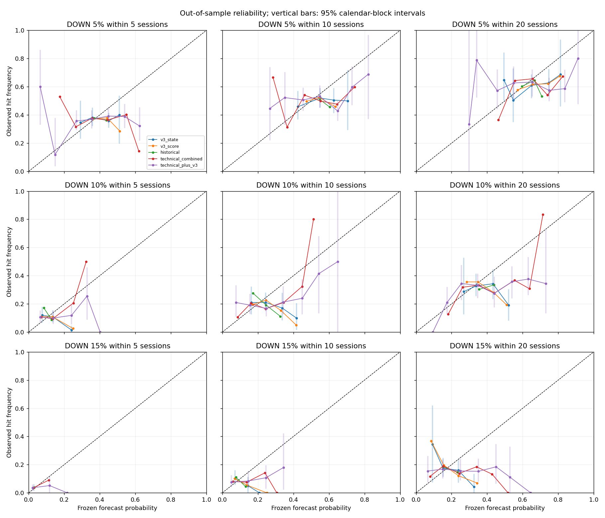
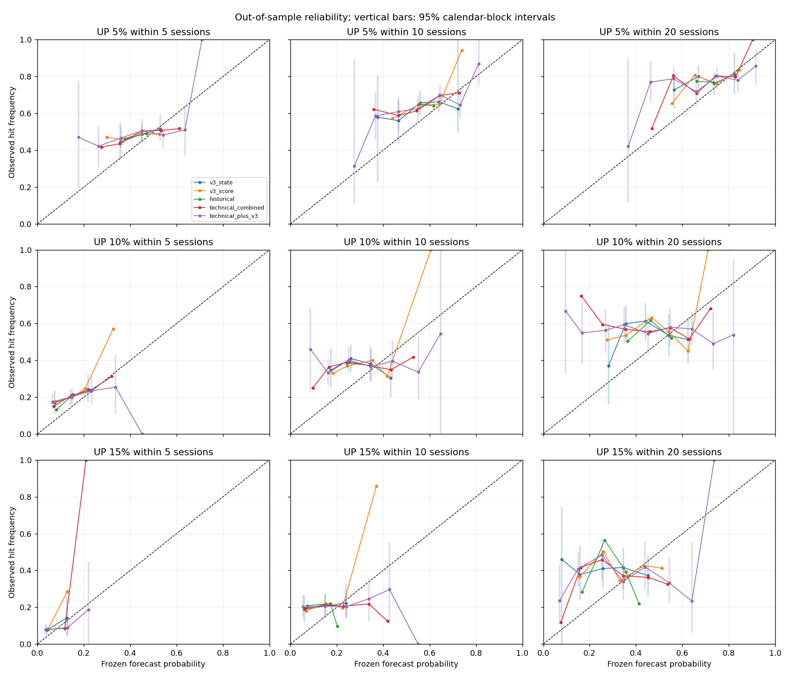
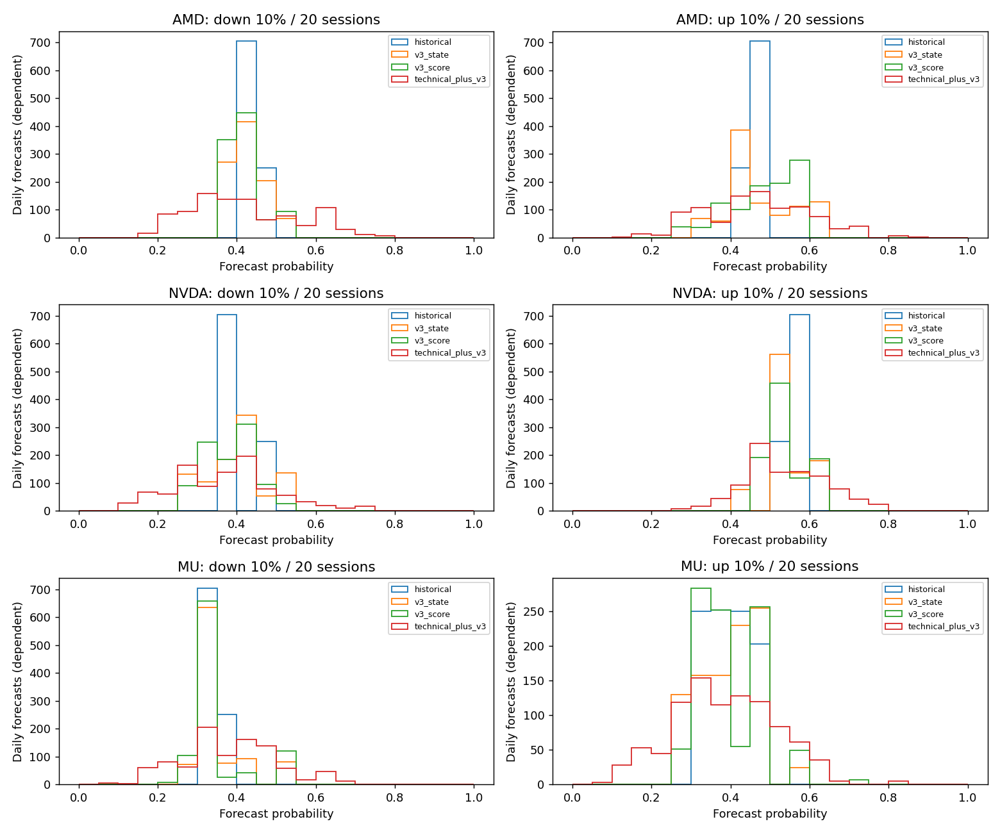

# Risk Forecast v1 — predictive information, not trading

**No trades, position-size policy, economic simulation or changes to REDUCE.** Protocol committed before results; compare all predeclared tasks, not a selected October result.

## Data and chronological design

Unchanged retrospective PR #5 pack inherited through PR #6: AMD/NVDA/MU, 2021–22 October 2026, with 2020 indicator warmup. No new or synthetic market data. 2021–2022 are training/descriptive only. Held-out probability predictions cover 2023–2026 using annual Jan 1 frozen estimators. For each fold replay its original C profile on earlier archived indicators; held-out states and scores are asserted identical to the original walk-forward outputs. 2026 remains C/sensitive; there is no new selection of REDUCE thresholds.

Each training anchor must have its **entire** forecast horizon published by the freeze timestamp. A hit that happened early does not authorize inclusion of an otherwise unfinished horizon. fit-audit.csv exports last anchor, last horizon publication, cutoff and excluded unmatured counts for every stock/task/fold. Daily predictors are immutable whitelisted feature objects; future labels reside in a separate evaluation function.

## Target and probability models

From the anchor Close, a DOWN hit uses any future Low <=95/90/85% and an UP hit any High >=105/110/115%, within 5/10/20 subsequent stock sessions. Anchor OHLC is excluded. Both labels can be true. First-hit dates establish ordering unless both barriers first occur in one daily bar; an opening gap beyond one barrier establishes that direction first, otherwise UNKNOWN_INTRADAY. Terminal close return is separate. Incomplete horizons have null full-horizon labels/returns, alongside observed-to-date hit bounds.

Eight transparent per-stock models: historical unconditional, matched dd20, matched RV20, MA50/RSI, v3 state, v3 score bin, joint technical cells, joint technical + v3 cells. Fixed bins and shrinkage=20 are in protocol.md; no test tuning. Incremental v3 cells shrink toward their identical technical parent, other cells toward stock training history. Unseen cells back off. LOW_SUPPORT flags cells with <60 anchors, <10 positives/negatives or occurrences in <5 calendar blocks. Numeric low-support values are auditable research point estimates, not reliable live probabilities; do not interpret extra decimal places as certainty.

## Confirmatory incremental comparison

0 of 18 predeclared tasks pass the combined criterion: Holm-adjusted p<0.05 across all 18 tasks, negative 95% paired Brier interval, >=1% relative Brier improvement and negative intervals for block20/40/60. **An incremental predictive advantage of v3 beyond the joint technical baseline is not confirmed under the predefined criterion.**

| Direction | Hit % | Sessions | Δ Brier [95% CI] | Relative improvement % | Holm p | Stable blocks | Criterion met |
|---|---|---|---|---|---|---|---|
| down | 5 | 5 | 0.0053 [0.0037, 0.0069] | -2.21 | 1.0000 | False | False |
| up | 5 | 5 | 0.0040 [0.0022, 0.0058] | -1.60 | 1.0000 | False | False |
| down | 10 | 5 | 0.0015 [0.0006, 0.0023] | -1.49 | 1.0000 | False | False |
| up | 10 | 5 | 0.0018 [0.0006, 0.0031] | -1.12 | 1.0000 | False | False |
| down | 15 | 5 | 0.0002 [-0.0001, 0.0004] | -0.46 | 1.0000 | False | False |
| up | 15 | 5 | 0.0008 [0.0005, 0.0012] | -1.13 | 1.0000 | False | False |
| down | 5 | 10 | 0.0053 [0.0028, 0.0080] | -2.05 | 1.0000 | False | False |
| up | 5 | 10 | 0.0041 [0.0017, 0.0067] | -1.75 | 1.0000 | False | False |
| down | 10 | 10 | 0.0025 [0.0005, 0.0045] | -1.53 | 1.0000 | False | False |
| up | 10 | 10 | 0.0045 [0.0017, 0.0070] | -1.80 | 1.0000 | False | False |
| down | 15 | 10 | 0.0009 [0.0000, 0.0018] | -1.18 | 1.0000 | False | False |
| up | 15 | 10 | 0.0027 [0.0014, 0.0038] | -1.57 | 1.0000 | False | False |
| down | 5 | 20 | 0.0068 [0.0039, 0.0098] | -2.72 | 1.0000 | False | False |
| up | 5 | 20 | 0.0043 [0.0024, 0.0063] | -2.29 | 1.0000 | False | False |
| down | 10 | 20 | 0.0046 [0.0017, 0.0074] | -2.02 | 1.0000 | False | False |
| up | 10 | 20 | 0.0070 [0.0040, 0.0101] | -2.58 | 1.0000 | False | False |
| down | 15 | 20 | 0.0037 [0.0017, 0.0061] | -2.53 | 1.0000 | False | False |
| up | 15 | 20 | 0.0077 [0.0052, 0.0100] | -2.87 | 1.0000 | False | False |

Negative Δ Brier/log loss favors added v3. Primary paired samples retain all stocks on the same calendar block; comparisons with standalone v3 state/score and each simple baseline are exploratory in baseline-comparison.csv. A failure to confirm is not proof that every possible estimator lacks signal. Strong state-frequency differences can reflect volatility, current drawdown or trend already captured by simpler models.

## Reference task: DOWN 10% within 20 sessions (all stocks)

| Model | N / effective N | Event rate [95% CI] | Mean forecast | Brier [95% CI] | Log loss | ROC-AUC | PR-AUC (AP) | Low-support forecasts % |
|---|---|---|---|---|---|---|---|---|
| historical | 2805 / 73.7 | 0.317 [0.233, 0.391] | 0.390 | 0.228 [0.210, 0.248] | 0.650 | 0.461 | 0.293 | 0.0 |
| drawdown | 2805 / 73.7 | 0.317 [0.233, 0.391] | 0.383 | 0.227 [0.207, 0.247] | 0.646 | 0.471 | 0.302 | 2.9 |
| volatility | 2805 / 73.7 | 0.317 [0.233, 0.391] | 0.386 | 0.224 [0.205, 0.246] | 0.639 | 0.564 | 0.349 | 12.7 |
| ma50_rsi | 2805 / 73.7 | 0.317 [0.233, 0.391] | 0.399 | 0.234 [0.215, 0.252] | 0.660 | 0.449 | 0.285 | 12.3 |
| v3_state | 2805 / 73.7 | 0.317 [0.233, 0.391] | 0.388 | 0.231 [0.212, 0.251] | 0.655 | 0.462 | 0.287 | 2.9 |
| v3_score | 2805 / 73.7 | 0.317 [0.233, 0.391] | 0.388 | 0.230 [0.211, 0.251] | 0.654 | 0.452 | 0.280 | 3.5 |
| technical_combined | 2805 / 73.7 | 0.317 [0.233, 0.391] | 0.392 | 0.230 [0.211, 0.250] | 0.652 | 0.508 | 0.334 | 82.9 |
| technical_plus_v3 | 2805 / 73.7 | 0.317 [0.233, 0.391] | 0.390 | 0.234 [0.215, 0.256] | 0.663 | 0.507 | 0.339 | 94.3 |

Full metrics.csv includes all tasks, stock-level estimates, confidence intervals, class counts, effective N, date/block counts and low-support status. PR-AUC is noninterpolated average precision with tied probabilities grouped; it is not trapezoidal PR area. ROC/AP are omitted if only one class occurs.

## Stock-level reference task: DOWN10 within20

| Stock | Historical Brier | RV20 Brier | v3-state Brier | Technical Brier | Technical + v3 Brier |
|---|---|---|---|---|---|
| AMD | 0.2408 | 0.2514 | 0.2435 | 0.2518 | 0.2576 |
| NVDA | 0.2153 | 0.2057 | 0.2115 | 0.2048 | 0.2082 |
| MU | 0.2291 | 0.2160 | 0.2393 | 0.2330 | 0.2378 |

Lower Brier is better. A modest individual improvement is exploratory and does not establish the primary incremental criterion. Joint technical cells are sparse: inspect LOW_SUPPORT rates in the main table (especially technical_plus_v3), not only point scores. This study cannot rule out every alternative estimator of the same information.

## State frequencies and numeric risk score

| Stock | State | N | DOWN10/20 frequency [95% CI] | Block/class support |
|---|---|---|---|---|
| ALL | HOLD | 862 | 0.287 [0.220, 0.388] | DEPENDENT_RESEARCH_ESTIMATE |
| ALL | WATCH | 806 | 0.316 [0.228, 0.417] | DEPENDENT_RESEARCH_ESTIMATE |
| ALL | REDUCE | 812 | 0.369 [0.234, 0.488] | DEPENDENT_RESEARCH_ESTIMATE |
| ALL | CRITICAL | 325 | 0.265 [0.153, 0.374] | DEPENDENT_RESEARCH_ESTIMATE |
| AMD | HOLD | 231 | 0.385 [0.266, 0.574] | DEPENDENT_RESEARCH_ESTIMATE |
| AMD | WATCH | 249 | 0.402 [0.278, 0.538] | DEPENDENT_RESEARCH_ESTIMATE |
| AMD | REDUCE | 312 | 0.413 [0.263, 0.548] | DEPENDENT_RESEARCH_ESTIMATE |
| AMD | CRITICAL | 143 | 0.266 [0.158, 0.369] | DEPENDENT_RESEARCH_ESTIMATE |
| NVDA | HOLD | 348 | 0.201 [0.113, 0.334] | DEPENDENT_RESEARCH_ESTIMATE |
| NVDA | WATCH | 270 | 0.248 [0.149, 0.364] | DEPENDENT_RESEARCH_ESTIMATE |
| NVDA | REDUCE | 241 | 0.295 [0.124, 0.462] | DEPENDENT_RESEARCH_ESTIMATE |
| NVDA | CRITICAL | 76 | 0.237 [0.000, 0.407] | DEPENDENT_RESEARCH_ESTIMATE |
| MU | HOLD | 283 | 0.311 [0.195, 0.451] | DEPENDENT_RESEARCH_ESTIMATE |
| MU | WATCH | 287 | 0.307 [0.190, 0.436] | DEPENDENT_RESEARCH_ESTIMATE |
| MU | REDUCE | 259 | 0.386 [0.235, 0.536] | DEPENDENT_RESEARCH_ESTIMATE |
| MU | CRITICAL | 106 | 0.283 [0.117, 0.475] | DEPENDENT_RESEARCH_ESTIMATE |

0/9 DOWN tasks have a positive exploratory 95% interval for the score-frequency slope. score-probabilities.csv retains exact scores; score-monotonicity.csv includes slopes and adjacent frequency reversals, for UP as well as DOWN. These are unadjusted diagnostics, not independent confirmations or monotonicity guarantees. A score can predict wider fluctuations in both directions without a directional forecasting advantage.

## Historical error examples (first chronological held-out example)

| Stock | Category | Date | Observed outcome / context |
|---|---|---|---|
| AMD | REDUCE_THEN_UP10_WITHIN20 | 2023-01-03 | UP 2023-01-12; DOWN None; order UP_ONLY; terminal20 32.21% |
| AMD | HOLD_THEN_DOWN10_WITHIN20 | 2023-02-01 | UP None; DOWN 2023-02-22; order DOWN_ONLY; terminal20 -4.96% |
| AMD | REDUCE_AFTER_HALF_OBSERVED_FALL | 2023-02-16 | Observed fall fraction 0.703; trough 2023-02-22 |
| AMD | GRADUAL_DETERIORATION_STILL_HOLD | 2023-12-20 | DD20 -3.339 vs 0.000; future DOWN10 False |
| NVDA | REDUCE_THEN_UP10_WITHIN20 | 2023-01-03 | UP 2023-01-09; DOWN None; order UP_ONLY; terminal20 46.30% |
| NVDA | HOLD_THEN_DOWN10_WITHIN20 | 2023-07-14 | UP None; DOWN 2023-08-11; order DOWN_ONLY; terminal20 -10.15% |
| NVDA | REDUCE_AFTER_HALF_OBSERVED_FALL | 2023-02-21 | Observed fall fraction 1.000; trough 2023-02-21 |
| NVDA | GRADUAL_DETERIORATION_STILL_HOLD | 2024-05-30 | DD20 -3.767 vs -0.457; future DOWN10 False |
| MU | REDUCE_THEN_UP10_WITHIN20 | 2023-01-03 | UP 2023-01-06; DOWN None; order UP_ONLY; terminal20 24.28% |
| MU | HOLD_THEN_DOWN10_WITHIN20 | 2023-01-27 | UP None; DOWN 2023-02-22; order DOWN_ONLY; terminal20 -9.35% |
| MU | REDUCE_AFTER_HALF_OBSERVED_FALL | 2023-04-04 | Observed fall fraction 0.962; trough 2023-04-05 |
| MU | GRADUAL_DETERIORATION_STILL_HOLD | 2023-03-28 | DD20 -3.358 vs -0.204; future DOWN10 False |

All qualifying cases (including training/descriptive examples) are retained in event-analysis.csv. A UP hit after REDUCE is not a proof of an erroneous risk assessment, especially if DOWN also hit. Late-warning labels use retrospective original event troughs only for evaluation. Gradual-HOLD rule is fixed in protocol.md; absence of a qualifying example is explicitly allowed.

In the held-out 10%/20-session reference task, 212/2805 daily anchors hit both barriers; 0 have unresolved same-day first-hit order. outcome-summary.csv also separates all other barrier tasks and their mean terminal returns. Forecast rows across horizons/thresholds/directions are repeated questions about the same paths, not independent observations.

## Dependence, uncertainty and limitations

- Calendar moving blocks of 40 sessions, sampled synchronously across stocks, preserve much of the 5/10/20-window overlap and common stock shocks. 399 resamples for metric/calibration intervals; 1999 for confirmatory paired differences; fixed seeds. Blocks20/60 and yearly metrics are exported. Stationarity over years is imperfect; 40-session blocks do not solve every regime dependence.
- Effective N uses capped Bartlett/Newey–West variance of daily panel means, lag40, and never exceeds the date count. It is a diagnostic, not a guarantee of independent trials. Irregular state/score/calibration subsets do not receive an invented effective N: they show raw counts, dates, calendar blocks and support warnings. Sparse events and wide intervals preclude precise reliable probabilities.
- Bootstrap conditions on frozen fitted estimators and this historical vintage; it does not include all training/selection uncertainty, establish causality or remove retrospective model-design bias. Holm applies only to the 18 primary incremental tests. Other stock/bin/horizon analyses are exploratory.
- Historical provider prices/corporate actions/publication times are not independently attested point-in-time vintages. A common split-adjusted OHLC basis and conservative next-midnight availability are inherited; dividend total returns are not targets here. No source revision or exchange-calendar completeness claim is made.
- Late September/October20-session forecasts often have unfinished outcomes at October22. october-diagnostic.csv retains all such forecasts with censoring; the research never substitutes observed partial hits or terminal values for completed horizons.
- The protocol and historical v3 design were specified after past outcomes became observable. Even an apparent positive task requires a fresh reserved future holdout and additional instruments. No conclusion of live-trading readiness or investment effectiveness is supported.

## Figures and reproduction

`OPENBLAS_NUM_THREADS=1 python -m aae.research.risk_forecast_study` runs offline. forecast-daily.csv has one anchor/horizon/threshold row with both directions, all model probabilities, raw training-cell support, hit chronology, terminal returns and maturity. Training-only rows contain no pseudo-held-out forecasts. calibration.csv and baseline-comparison.csv meet the requested formats; supplementary metrics/state/score/fit-audit/block/year tables make uncertainty and purging auditable. validation.md records tests and unresolved historical checks. run.json hashes inputs/code/outputs.
