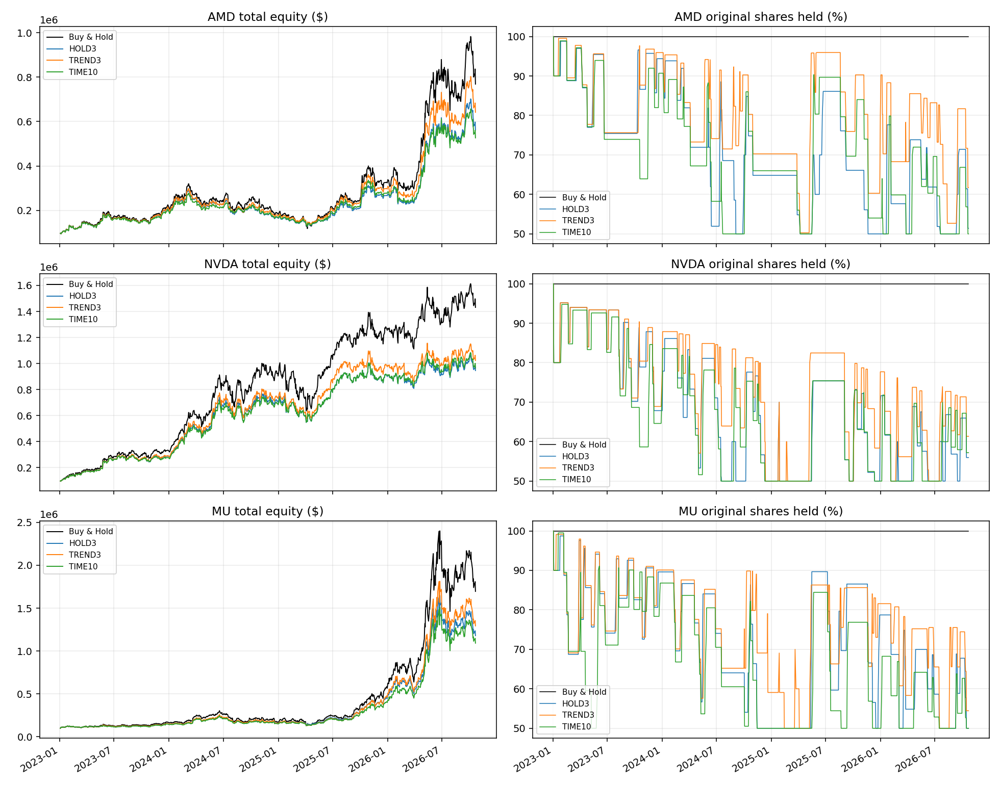
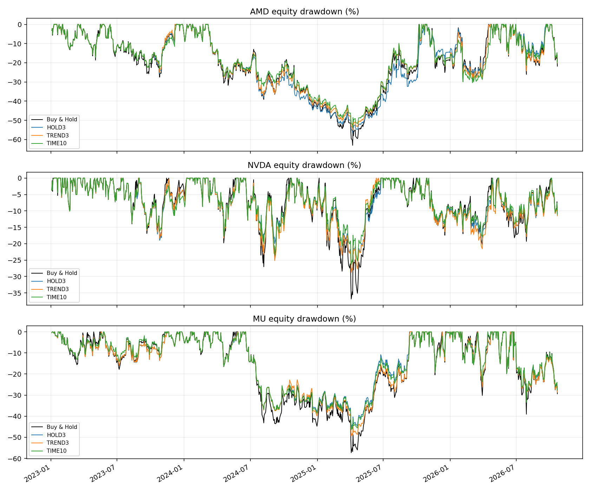

# Risk Signal v3 — economic backtest

Research-only execution of unchanged PR #5 C walk-forward signals. No merges, deployments, live orders or production changes. Protocol was committed before economic calculations; no policy/size winner is selected by 2026 returns. The principal size remains 10%.

## Data and accounting

Frozen Yahoo AMD/NVDA/MU prices and corporate-action responses from PR #5, warm-up 2020–2022, trading 2023 through 22 October 2026. 23 October is excluded. No new market observations or invented prices. Raw OHLCV/action manifest and adjusted split continuity reconciled in data-quality.json; original sources/retrieval times/hashes remain in data/risk-signal-v3/.

Use one provider split-adjusted OHLC/share/dividend basis. The NVDA 2024 10:1 split is not applied again. Gross dividends accrue to pre-ex-date-open holdings in a separate non-spendable receivable because payment dates are unavailable. Total cash = spendable cash + receivable; NAV = total cash + shares*close. Price-only sensitivity is explicit. Taxes, interest, market impact and terminal liquidation are excluded. Provider dividends/adjustments are not independently verified; payment and vintage limitations prevent a definitive investable total-return claim.

Opens are checked at 09:30 America/New_York; full OHLCV matches frozen raw responses. PR #5 uses conservative next-midnight availability and assumes 6.5-hour sessions: early closes are delayed, not traded early. There is no independently attested historical publication archive or exchange-calendar completeness audit. These are retrospective diagnostic results, not proven investment effectiveness.

## Fixed policy

Full rules: [protocol.md](protocol.md). First high-risk entry sells 10% original shares; first CRITICAL adds 10%, including a combined 20% order for direct CRITICAL. Rearm only after three valid WATCH/HOLD sessions. One sale permission of each type per episode; REDUCE↔CRITICAL chatter does not repeatedly sell. Minimum 50% original shares. The no-CRITICAL control isolates the first reduction.

HOLD3 restores after three consecutive HOLD; TREND3 after three consecutive WATCH/HOLD with close>MA20 and positive MA20 five-session slope; TIME10 after ten consecutive WATCH/HOLD. Once confirmed, restore one tranche per session, next-open execution, bounded by cash and original shares. New risk/invalid data cancels queued buys; firm queued sells stay scheduled. Buy & Hold shares/costs at inception match Tactical. Costs are 5 bps fee plus 5 bps adverse slippage, fractional shares, no leverage. Initial observation of high risk may qualify in a fresh account and is explicitly flagged.

Frozen signal configurations (unchanged): 2023: C/sensitive trained through 2022-12-31, 2024: C/sensitive trained through 2023-12-31, 2025: C/sensitive trained through 2024-12-31, 2026: C/sensitive trained through 2025-12-31.

## Full continuous test: 2023–22 October 2026

| Stock | Policy | Return % | CAGR % | Max DD % | Sharpe | Final NAV $ | Δ vs B&H $ | Fees+slippage $ | Profitable completed lots % |
|---|---|---|---|---|---|---|---|---|---|
| AMD | Buy & Hold | 668.82 | 71.04 | -63.00 | 1.23 | 768,821.88 | 0.00 | 99.93 | — |
| AMD | HOLD3 +CRITICAL | 462.81 | 57.56 | -56.73 | 1.20 | 562,805.39 | -206,016.49 | 2,039.10 | 22.58 |
| AMD | HOLD3 REDUCE only | 514.30 | 61.24 | -58.89 | 1.21 | 614,302.11 | -154,519.77 | 1,832.10 | 16.67 |
| AMD | TREND3 +CRITICAL | 541.85 | 63.11 | -55.12 | 1.24 | 641,848.93 | -126,972.96 | 2,747.45 | 33.33 |
| AMD | TREND3 REDUCE only | 615.34 | 67.83 | -58.00 | 1.26 | 715,341.46 | -53,480.43 | 1,970.13 | 33.33 |
| AMD | TIME10 +CRITICAL | 426.66 | 54.84 | -53.65 | 1.17 | 526,660.68 | -242,161.20 | 2,242.32 | 18.75 |
| AMD | TIME10 REDUCE only | 469.33 | 58.04 | -58.05 | 1.17 | 569,334.35 | -199,487.54 | 1,935.54 | 16.00 |
| NVDA | Buy & Hold | 1,331.54 | 101.44 | -36.87 | 1.70 | 1,431,535.64 | 0.00 | 99.93 | — |
| NVDA | HOLD3 +CRITICAL | 845.80 | 80.63 | -28.78 | 1.68 | 945,798.22 | -485,737.42 | 6,716.28 | 7.32 |
| NVDA | HOLD3 REDUCE only | 972.22 | 86.69 | -25.45 | 1.76 | 1,072,219.32 | -359,316.33 | 6,759.21 | 14.29 |
| NVDA | TREND3 +CRITICAL | 923.11 | 84.40 | -28.83 | 1.69 | 1,023,107.73 | -408,427.91 | 8,424.46 | 12.50 |
| NVDA | TREND3 REDUCE only | 1,068.17 | 90.95 | -31.14 | 1.71 | 1,168,170.79 | -263,364.85 | 6,866.33 | 13.89 |
| NVDA | TIME10 +CRITICAL | 863.58 | 81.51 | -26.44 | 1.70 | 963,578.33 | -467,957.32 | 6,102.13 | 2.70 |
| NVDA | TIME10 REDUCE only | 991.78 | 87.58 | -24.13 | 1.78 | 1,091,777.40 | -339,758.25 | 6,195.83 | 12.12 |
| MU | Buy & Hold | 1,595.93 | 110.63 | -57.31 | 1.55 | 1,695,930.16 | 0.00 | 99.93 | — |
| MU | HOLD3 +CRITICAL | 1,079.83 | 91.45 | -45.38 | 1.57 | 1,179,834.53 | -516,095.63 | 4,000.17 | 20.51 |
| MU | HOLD3 REDUCE only | 1,247.32 | 98.25 | -46.73 | 1.60 | 1,347,317.87 | -348,612.30 | 3,665.29 | 25.00 |
| MU | TREND3 +CRITICAL | 1,193.91 | 96.15 | -49.45 | 1.57 | 1,293,909.80 | -402,020.37 | 4,901.22 | 21.28 |
| MU | TREND3 REDUCE only | 1,387.42 | 103.48 | -54.40 | 1.56 | 1,487,424.05 | -208,506.11 | 3,788.86 | 26.47 |
| MU | TIME10 +CRITICAL | 992.26 | 87.60 | -46.45 | 1.54 | 1,092,255.72 | -603,674.44 | 3,249.05 | 22.86 |
| MU | TIME10 REDUCE only | 1,073.76 | 91.19 | -47.07 | 1.55 | 1,173,763.08 | -522,167.09 | 3,286.12 | 20.69 |

Sharpe uses daily total-equity returns including inception costs, sample SD, risk-free=0 and sqrt(252). CAGR is omitted for periods shorter than 365 calendar days. No portfolio aggregation across correlated stocks. Independent accounts for every subperiod start at $100,000 and reset execution state; continuous full-period results inherit state across years. Summary account_mode=inherited gives slices of that same continuous account, with inherited initial capital and a separate period_pnl_difference_vs_buy_hold; its final equity difference includes earlier years. Their dollar outcomes must not be treated as the same experiment.

## Independent period controls: principal HOLD3, CRITICAL enabled

| Period | Stock | Tactical return % | Δ return vs B&H, pp | DD reduction, pp | Δ final NAV $ | Ending missing shares |
|---|---|---|---|---|---|---|
| 2023-2024 | AMD | 64.77 | -18.06 | -0.86 | -18,059.54 | 532.42 |
| 2023-2024 | NVDA | 601.53 | -202.15 | 7.03 | -202,152.55 | 3,363.41 |
| 2023-2024 | MU | 58.78 | -9.33 | 6.85 | -9,325.10 | 987.94 |
| 2025 | AMD | 58.77 | -16.18 | 9.84 | -16,177.63 | 408.46 |
| 2025 | NVDA | 26.72 | -10.31 | 9.04 | -10,308.50 | 123.01 |
| 2025 | MU | 190.49 | -45.57 | 14.99 | -45,573.57 | 159.29 |
| 2026 | AMD | 105.68 | -26.13 | 0.85 | -26,128.21 | 150.85 |
| 2026 | NVDA | 0.49 | -11.45 | 2.75 | -11,449.20 | 107.05 |
| 2026 | MU | 156.20 | -33.87 | 5.49 | -33,868.72 | 113.49 |
| SepOct2026 | AMD | 9.95 | -0.38 | 1.42 | -380.60 | 48.07 |
| SepOct2026 | NVDA | -2.35 | -0.27 | 0.12 | -269.44 | 47.98 |
| SepOct2026 | MU | -8.37 | 0.70 | 1.47 | 699.49 | 22.38 |

## October 2026: full continuous account, HOLD3, CRITICAL enabled

| Stock | Signal / kind | Close | Sale date / fill | Next closing trough / price | Extra fall % | Full lot buyback / avg fill | Net contribution $ | Completed? |
|---|---|---|---|---|---|---|---|---|
| AMD | 2026-10-12 REDUCE | 594.24 | 2026-10-13 / 577.21 | 2026-10-16 / 528.75 | 8.40 | OPEN / — | 10,442.99 | False |
| AMD | 2026-10-19 CRITICAL | 538.05 | 2026-10-20 / 529.76 | 2026-10-20 / 534.74 | 0.00 | OPEN / — | 3,263.42 | False |
| AMD | 2026-10-21 REDUCE | 552.72 | EPISODE_PERMISSION_SPENT / — | — / — | — | OPEN / — | — | False |
| AMD | 2026-10-22 CRITICAL | 507.93 | EPISODE_PERMISSION_SPENT / — | — / — | — | OPEN / — | — | False |
| NVDA | 2026-10-14 REDUCE | 221.30 | 2026-10-15 / 215.19 | 2026-10-16 / 214.13 | 0.49 | OPEN / — | 1,933.79 | False |
| MU | 2026-10-09 REDUCE | 1,029.00 | 2026-10-12 / 1,001.95 | 2026-10-14 / 914.13 | 8.76 | OPEN / — | 28,612.17 | False |
| MU | 2026-10-14 CRITICAL | 914.13 | 2026-10-15 / 871.14 | 2026-10-16 / 878.84 | 0.00 | OPEN / — | 2,176.56 | False |
| MU | 2026-10-21 REDUCE | 913.67 | EPISODE_PERMISSION_SPENT / — | — / — | — | OPEN / — | — | False |
| MU | 2026-10-22 CRITICAL | 856.49 | EPISODE_PERMISSION_SPENT / — | — / — | — | OPEN / — | — | False |

The table includes CRITICAL add-ons and blocked entries. Open-lot contribution is an unrealized relative mark at October 22, not booked trading profit. october-2026.csv also includes independent 2026 and Sep–Oct accounts and all recovery controls. A confirmed local trough is a closing low <=previous close and <next close; where unavailable, the observed minimum is right-censored. No minimum or forward label is an execution input.

## Quantitative answers: principal 10%, HOLD3, CRITICAL enabled

- **AMD:** Δ final NAV -206,016.49 USD; Δ return -206.02 pp; maximum-drawdown reduction 6.27 pp. 81.08% of confirmed-trough lots have positive actual net protection; 22.58% of completed lots are profitable; grouping direct-CRITICAL components into a single first-REDUCE event gives 19.05% profitable completed REDUCE signals (n=21). Sale followed by +20-session price growth: 56.00% of 25 classified REDUCE lots. Stricter false-growth REDUCE labels: 13/25 classified lots (52.00%), associated negative net contribution 102,406.18 USD. Missed gross recovery growth 241,465.59 USD (overlapping opportunity measure, not an extra NAV deduction). Recovery-rule Δ NAV range -242,161.20 to -126,972.96 USD. Ending deficit 735.31 adjusted-basis shares; receivable 0.00 USD.
- **NVDA:** Δ final NAV -485,737.42 USD; Δ return -485.74 pp; maximum-drawdown reduction 8.09 pp. 56.52% of confirmed-trough lots have positive actual net protection; 7.32% of completed lots are profitable; grouping direct-CRITICAL components into a single first-REDUCE event gives 9.68% profitable completed REDUCE signals (n=31). Sale followed by +20-session price growth: 71.43% of 35 classified REDUCE lots. Stricter false-growth REDUCE labels: 25/35 classified lots (71.43%), associated negative net contribution 280,514.11 USD. Missed gross recovery growth 495,747.30 USD (overlapping opportunity measure, not an extra NAV deduction). Recovery-rule Δ NAV range -485,737.42 to -408,427.91 USD. Ending deficit 2,962.83 adjusted-basis shares; receivable 2,356.24 USD.
- **MU:** Δ final NAV -516,095.63 USD; Δ return -516.10 pp; maximum-drawdown reduction 11.93 pp. 77.78% of confirmed-trough lots have positive actual net protection; 20.51% of completed lots are profitable; grouping direct-CRITICAL components into a single first-REDUCE event gives 21.43% profitable completed REDUCE signals (n=28). Sale followed by +20-session price growth: 62.50% of 32 classified REDUCE lots. Stricter false-growth REDUCE labels: 17/32 classified lots (53.12%), associated negative net contribution 155,438.64 USD. Missed gross recovery growth 638,302.22 USD (overlapping opportunity measure, not an extra NAV deduction). Recovery-rule Δ NAV range -603,674.44 to -402,020.37 USD. Ending deficit 987.94 adjusted-basis shares; receivable 2,518.09 USD.

Protection at a retrospective trough measures contribution at that date; it is not the final round-trip outcome. actual_trough_protection_sum sums different, potentially overlapping dates and is NOT portfolio profit. Exact final reconciliation uses realized lot contributions + open lot marks (both already net of their allocated missed dividends), with each dividend counted once; this equals Tactical NAV minus Buy & Hold in every simulation. Closed profitable lots exclude unfinished lots. Average reduced-spell duration includes the observed length of an open spell (a censored lower bound); even a small unrecovered fee-related share deficit keeps that spell open. Quantity-weighted matched absence is separately reported, so it is not confused with signal-state duration. Repeated reductions can share one REDUCE entry; signal IDs and component lots are retained to avoid treating components as independent predictions.

## Size, latency and corporate-action sensitivity

| Stock | Tranche % | Delay sessions | Δ NAV $ | Deviation from linear 10% scaling $ |
|---|---|---|---|---|
| AMD | 5 | 1 | -160,744.73 | -57,736.48 |
| AMD | 10 | 1 | -206,016.49 | 0.00 |
| AMD | 10 | 2 | -190,947.11 | 0.00 |
| AMD | 10 | 3 | -209,923.19 | 0.00 |
| AMD | 15 | 1 | -194,271.98 | 114,752.76 |
| AMD | 25 | 1 | -229,471.74 | 285,569.50 |
| NVDA | 5 | 1 | -293,462.74 | -50,594.03 |
| NVDA | 10 | 1 | -485,737.42 | 0.00 |
| NVDA | 10 | 2 | -419,917.77 | 0.00 |
| NVDA | 10 | 3 | -422,937.22 | 0.00 |
| NVDA | 15 | 1 | -598,406.43 | 130,199.71 |
| NVDA | 25 | 1 | -636,748.79 | 577,594.77 |
| MU | 5 | 1 | -316,687.03 | -58,639.22 |
| MU | 10 | 1 | -516,095.63 | 0.00 |
| MU | 10 | 2 | -575,819.38 | 0.00 |
| MU | 10 | 3 | -626,894.00 | 0.00 |
| MU | 15 | 1 | -575,649.69 | 198,493.75 |
| MU | 25 | 1 | -600,827.08 | 689,411.99 |

sensitivity.csv retains all 216 size/recovery/CRITICAL/latency configurations plus 18 price-only controls. Cash constraints, the 50% floor, finite tranches and restored-share deficits can make scaling nonlinear. No best-size recommendation is inferred. Delay 1 is next open; delays 2/3 add one/two sessions. Missing/last-day executions are never manufactured.

## Dividend convention sensitivity: principal HOLD3

| Stock | Δ NAV including restricted dividends $ | Δ NAV price-only $ | Difference $ |
|---|---|---|---|
| AMD | -206,016.49 | -206,016.49 | 0.00 |
| NVDA | -485,737.42 | -484,057.56 | -1,679.86 |
| MU | -516,095.63 | -514,997.88 | -1,097.75 |

## Interpretation and limits

In this source vintage, 18/18 full-period primary recovery/CRITICAL controls finish below Buy & Hold. Principal HOLD3 drawdown reduction is 6.27–11.93 pp, at a cumulative-return cost of 206.02–516.10 pp. Smaller drawdowns do not compensate lost terminal wealth under a terminal-NAV objective. An investor's preference between return and drawdown cannot be inferred from these numbers alone.

The economic criterion is final NAV after costs alongside drawdown, not merely the ability to flag a decline. Positive protection followed by costly re-entry can destroy the earlier benefit; remaining below the original share count also reduces future participation. Compare all three recovery rules and the CRITICAL-disabled controls rather than presenting the best retrospective return as independent validation. Numerical trade-offs above quantify whether protection compensates lost returns for each stock and policy; no utility preference for drawdown versus return is assumed.

There is no established universal economic advantage over Buy & Hold from this retrospective sample. Even a positive individual result is diagnostic: the signal catalogue and execution policies were developed after outcomes became observable. Independent verified price/action/publication vintages, actual dividend payment dates, a reserved future holdout, additional instruments, and execution/market-impact validation are needed before any investment-effectiveness claim.

## Artifacts and reproduction

`python -m aae.research.risk_v3_economic_study` runs offline. summary/recovery-comparison cover all independent periods; trades, recovery-matches, daily-equity, signal-events and cancelled-orders audit primary/control executions. Sensitivity contains summary outputs for every fixed combination and is reproducible with the same runner. signal-economics includes blocked/unfilled signals as well as actual lots. drawdown-protection includes every original C walk-forward >=10% event, true old-peak recovery dates and censored episodes. Never substitute a trailing-20 high for recovery of an old peak. validation.md lists checks and historical limitations; run.json records hashes.
